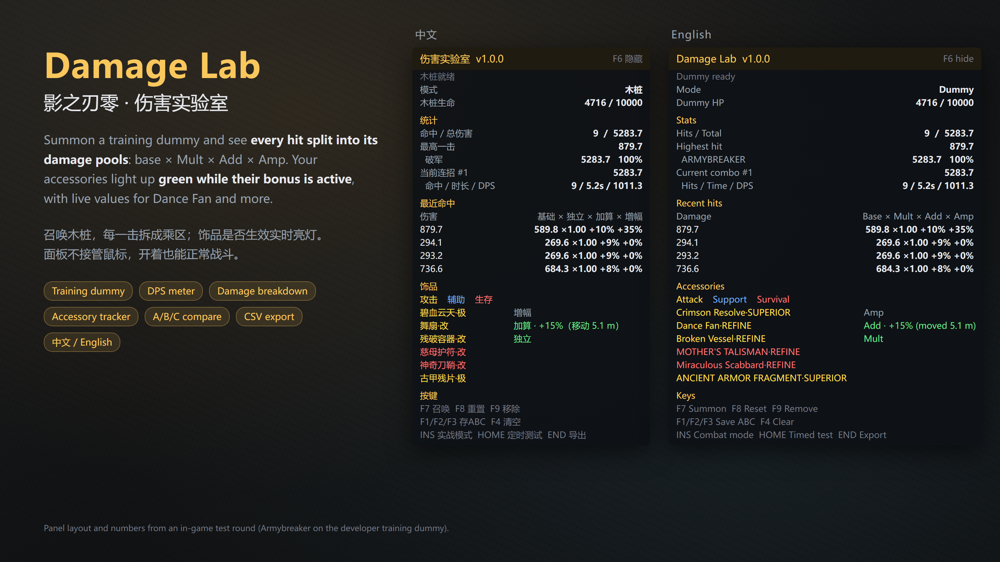

# Damage Lab (伤害实验室) for Phantom Blade Zero

A UE4SS Lua mod: summon a training dummy, see every hit split into the damage pools the game uses, and check which of your accessories are active right now. The panel never takes the mouse, so the camera and controls stay free while it is open.

中文说明见 [README_zh.md](README_zh.md).

## Download

- **Nexus Mods**: https://www.nexusmods.com/phantombladezero/mods/548
- **GitHub**: `PBZDamageLab-x.y.z.zip` from [Releases](../../releases), or copy the `PBZDamageLab` folder from this repository.

## Requirements

- Phantom Blade Zero, Steam build 26367565 (engine CL 302256). Other builds show a warning on the panel and may not work.
- UE4SS For Phantom Blade Zero 1.0.3 (Nexus Mods).

## Install

1. Install UE4SS For Phantom Blade Zero first.
2. Copy the `PBZDamageLab` folder into `ue4ss/Mods/` (next to `mods.txt`), e.g. `...\steamapps\common\PBZ\platform\steam\ue4ss\Mods\PBZDamageLab`.
3. Add `PBZDamageLab : 1` to `ue4ss/Mods/mods.txt`, above the `Keybinds` line.
4. If you use the "PBZ Damage Test" training dummy mod, set it to `: 0` so two dummies don't spawn.
5. In game, press F7 to summon the dummy and F6 to show / hide the panel.

## Keys

Change them in `PBZDamageLab/config.ini` (restart the game after editing). Insert is written `INS`.

| Key | Action |
|---|---|
| F6 | Show / hide the panel |
| F7 | Summon the dummy in front of you |
| F8 | Reset statistics |
| F9 | Remove the dummy |
| F1 / F2 / F3 | Save this round as set A / B / C |
| F4 | Clear the comparison |
| Insert | Combat mode: also count damage to real enemies and bosses |
| Home | Timed test (30 s, starts on your first hit) |
| End | Export this round's hits to CSV |

## Features

- **Training dummy**: the game's developer hit-only dummy. Never fights back or deflects, health refills, fixed in place.
- **Per-hit breakdown**: base × Mult × (1 + Add) × (1 + Amp), with the values each attack started with.
- **Stats**: hits, total, highest hit, damage per weapon, current combo with DPS. Executions are not counted.
- **Accessories**: every equipped accessory with its damage pool; green while its bonus is active. Live values for Dance Fan, Twin Fish Pendant and Talisman of Despair.
- **Build compare**, **timed test**, **CSV export**, **combat mode**.
- Chinese / English panel, follows the game language.

## Damage formula (measured on the dummy)

`damage = base × independent multipliers × (1 + additive pool) × (1 + amplification pool)`

- **Mult**: QUICK HAND MIGHT / PAIR / PENDANT, Broken Vessel, weapon level bonuses
- **Add**: Dance Fan
- **Amp**: Crimson Resolve, Twin Fish Pendant, BATTLE WRAPS, Desperate Stand, Snow and Blood
- An attack's damage is fixed when it starts; buffs triggered mid-attack apply from the next attack.

## Bug reports

Set `Debug = true` in `config.ini`, restart, reproduce the problem, then open an issue with `ue4ss/UE4SS.log` attached.

## Credits

- Dummy spawning and health handling adapted from **PBZ Damage Test / PBZTrainingDummy** by xbunax (MIT, see `PBZDamageLab/LICENSE-PBZTrainingDummy.txt`).
- On-screen panel widget approach from **ue4ss-ModMenu** by mattdavida (MIT, see `PBZDamageLab/LICENSE-ModMenu.txt`).
- Made with AI assistance (Claude); the preview images are rendered from the mod's panel layout.

## License

MIT, see [LICENSE](LICENSE).
