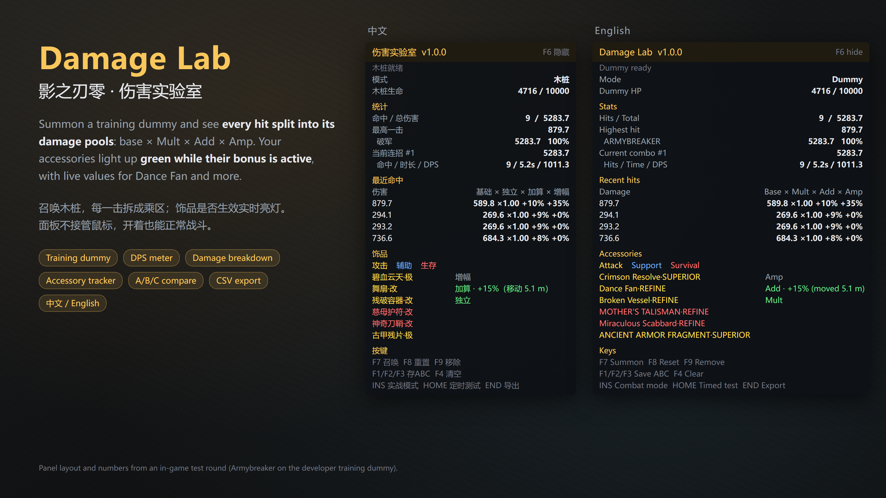

# 影之刃零 伤害实验室（Damage Lab）

一个 UE4SS Lua mod：召唤训练木桩，把每一击拆成游戏实际使用的伤害乘区，并实时显示你身上的饰品有没有在生效。面板不接管鼠标，开着也能正常转视角、正常战斗。

English: [README.md](README.md)

## 下载

- **Nexus Mods**：https://www.nexusmods.com/phantombladezero/mods/548
- **GitHub**：在 [Releases](../../releases) 下载 `PBZDamageLab-x.y.z.zip`，或者直接复制本仓库里的 `PBZDamageLab` 文件夹。

## 需要

- 影之刃零 Steam 版 26367565（引擎 CL 302256）。其他版本面板上会提示“未经验证”，可能无法正常工作。
- UE4SS For Phantom Blade Zero 1.0.3（Nexus Mods）。

## 安装

1. 先安装 UE4SS For Phantom Blade Zero。
2. 把 `PBZDamageLab` 文件夹复制到 `ue4ss/Mods/`（和 `mods.txt` 同一层），例如 `...\steamapps\common\PBZ\platform\steam\ue4ss\Mods\PBZDamageLab`。
3. 在 `ue4ss/Mods/mods.txt` 里 `Keybinds` 那一行之前加一行 `PBZDamageLab : 1`。
4. 如果装了 “PBZ Damage Test” 木桩 mod，把它改成 `: 0`，避免同时召唤出两个木桩。
5. 进入游戏后按 F7 召唤木桩，F6 显示 / 隐藏面板。

## 按键

在 `PBZDamageLab/config.ini` 里修改（改完重启游戏）。Insert 键写作 `INS`。

| 按键 | 作用 |
|---|---|
| F6 | 显示 / 隐藏面板 |
| F7 | 在面前召唤木桩 |
| F8 | 重置统计 |
| F9 | 移除木桩 |
| F1 / F2 / F3 | 把这一轮存为方案 A / B / C |
| F4 | 清空对比 |
| Insert | 实战模式：同时统计对真实敌人和 Boss 的伤害 |
| Home | 定时测试（30 秒，打出第一击开始） |
| End | 把这一轮的命中导出成 CSV |

## 功能

- **训练木桩**：游戏里开发者留下的只挨打木桩，不还手、不格挡、血量自动回满、固定不动。
- **逐击拆解**：基础 × 独立 × (1 + 加算) × (1 + 增幅)，取这一招起手时的数值。
- **统计**：命中、总伤害、最高一击、各武器占比、当前连招和 DPS。处决伤害不计入。
- **饰品**：列出所有装备的饰品和所在乘区，生效时亮绿灯。舞扇、同心双鱼佩、绝望护符显示实时加成。
- **方案对比**、**定时测试**、**导出 CSV**、**实战模式**。
- 中英文面板，跟随游戏语言。

## 伤害公式（木桩实测）

`伤害 = 基础 × 独立乘区 × (1 + 加算池) × (1 + 增幅池)`

- **独立乘区**：妙手千钧 / 妙手连环 / 妙手在握、残破容器、武器等级加成
- **加算池**：舞扇
- **增幅池**：碧血云天、同心双鱼佩、筋力绑带、绝地求生令、雪与血
- 一招的伤害在起手时就锁定了，多段攻击中途触发的增益要到下一招才生效。

## 反馈问题

把 `config.ini` 里的 `Debug` 改成 `true`，重启游戏，重现问题后开一个 Issue，附上 `ue4ss/UE4SS.log`。

## 致谢

- 木桩召唤和锁血逻辑改编自 xbunax 的 **PBZ Damage Test / PBZTrainingDummy**（MIT，见 `PBZDamageLab/LICENSE-PBZTrainingDummy.txt`）。
- 屏幕面板的实现方式参考 mattdavida 的 **ue4ss-ModMenu**（MIT，见 `PBZDamageLab/LICENSE-ModMenu.txt`）。
- 本 mod 在 AI（Claude）协助下制作；预览图按 mod 面板样式渲染。

## 许可

MIT，见 [LICENSE](LICENSE)。
